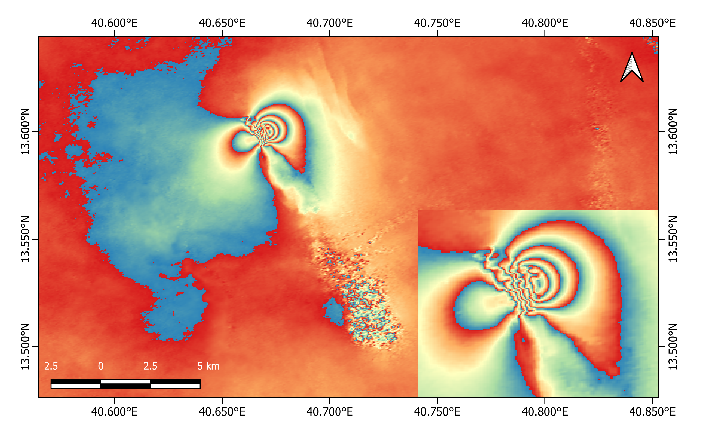
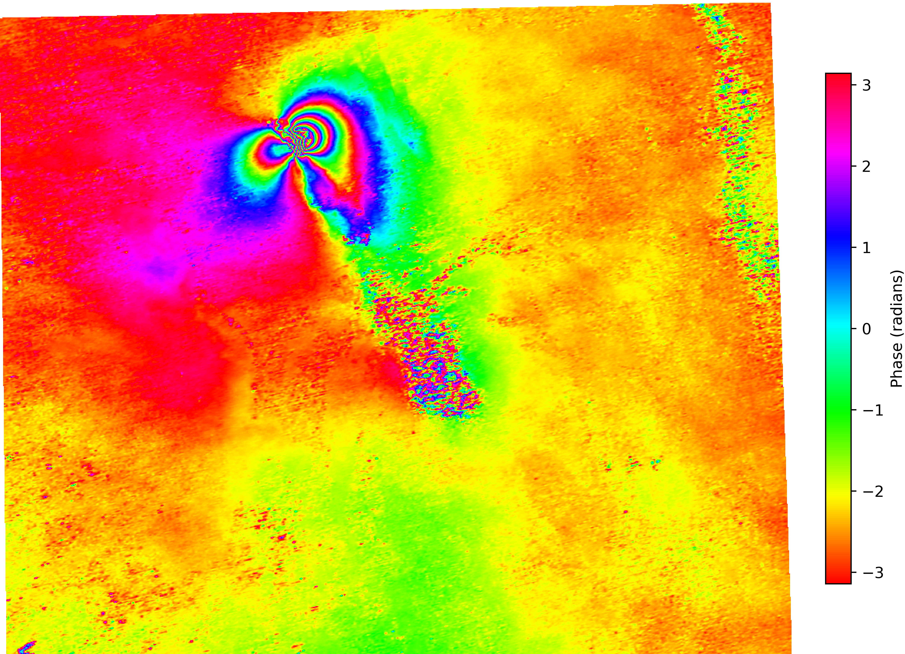

# 🚀 NISAR InSAR Processing Workflow (ISCE3)

<p align="center">
  
</p>

<p align="center">
  <b>NISAR SAR Interferometric Processing Using ISCE3</b>
</p>

<p align="center">
  
  
  
  
</p>

---

## 📌 Overview

This repository provides a **complete workflow for processing NISAR InSAR data using the ISCE3 framework**.

It enables the transformation of Radar Single Look Complex (RSLC) data into geocoded interferometric products through a structured processing chain.

The workflow includes environment setup, dependency installation, configuration preparation, interferometric processing, phase unwrapping, and geocoding.

### 🎯 Objectives

- Process NISAR RSLC datasets using ISCE3.
- Perform SAR image coregistration.
- Generate interferograms.
- Estimate dense offsets and perform rubbersheet correction.
- Apply phase filtering and phase unwrapping.
- Generate geocoded InSAR products.

---

## 🖥️ System Compatibility

| Operating System | Compatibility |
|:---|:---|
| 🐧 Ubuntu 24.04 or later | Recommended |
| 🍎 macOS | Supported |

### System Requirements

- Anaconda or Miniconda
- Python version compatible with the selected ISCE3 build
- Sufficient RAM for large RSLC datasets
- Adequate disk space for intermediate and final products

---

## 🛰️ Dataset Used

NISAR datasets can be accessed through the [Alaska Satellite Facility (ASF) Data Search](https://search.asf.alaska.edu/#/?dataset=NISAR&prodConfig=PR).

### Input RSLC Datasets

```text
NISAR_L1_PR_RSLC_005_172_A_008_2005_DHDH_A_20251122T024618_20251122T024652_X05007_N_F_J_001

NISAR_L1_PR_RSLC_006_172_A_008_2005_DHDH_A_20251204T024618_20251204T024653_X05007_N_F_J_001
```

---

## 🧰 Technology Stack

| Tool | Purpose |
|:---|:---|
| 🐍 Python | Core programming environment |
| 🛰️ ISCE3 | InSAR processing engine |
| 🗺️ GDAL | Raster and geospatial processing |
| 📦 HDF5 / h5py | Scientific data handling |
| 🧮 NumPy | Numerical computation |
| 🔬 SciPy | Scientific computation |
| 📊 Pandas | Data analysis |
| 🔓 SNAPHU | Phase unwrapping |
| 🌦️ PyAPS3 | Atmospheric correction |
| 🖼️ Matplotlib | Data visualization |

---

## ⚙️ Installation & Execution

### 🟢 Step 1 — Create Conda Environment

Create a new Conda environment with the Python version supported by your ISCE3 installation.

```bash
conda create -n isce3 python=3.13
```

### 🟢 Step 2 — Activate Environment

```bash
conda activate isce3
```

### 🟢 Step 3 — Install ISCE3

```bash
conda install -c conda-forge isce3
```

### 🟢 Step 4 — Install GDAL

```bash
conda install -c conda-forge gdal
```

### 🟢 Step 5 — Install Python Libraries

```bash
pip install pyaps3 pandas h5py numpy scipy matplotlib netcdf4 rasterio pyproj shapely
```

### 🟢 Step 6 — Install SNAPHU

```bash
conda install -c conda-forge snaphu
```

### 🟢 Step 7 — Install GDAL HDF5 Support

```bash
conda install -c conda-forge libgdal-hdf5
```

> **Note:** Ensure that Python, ISCE3, GDAL, and the associated libraries are compatible within the same Conda environment.

---

## 🔧 Verify Installation

### Check Python

```bash
python --version
which python
```

### Check NISAR Module

```bash
python -c "import nisar; print(nisar.__file__)"
```

### Check ISCE3

```bash
python -c "import isce3; print('ISCE3 imported successfully')"
```

### Check GDAL

```bash
gdalinfo --version
```

---

## ⚙️ NISAR InSAR Workflow Execution

### 🟢 Step 1 — Generate Run Configuration

Generate the configuration file using the option supported by your installed NISAR workflow version.

```bash
python -m nisar.workflows.insar --generate-config > insar.yaml
```

### 🟢 Step 2 — Configure YAML File

The configuration file is maintained in the `docs/` directory.

```text
docs/
└── insar.yaml
```

Update the configuration with the appropriate:

- Reference RSLC input path
- Secondary RSLC input path
- DEM file path
- Output directory
- Processing parameters
- Geocoding options

### 🟢 Step 3 — Run InSAR Workflow

Execute the processing workflow using the configuration file.

```bash
python -m nisar.workflows.insar docs/insar.yaml
```

> **Important:** The configuration-generation command and workflow entry point may vary with the installed NISAR/ISCE3 version. Verify the available options before execution.

---

## ✅ Workflow Summary

```text
Environment Setup
        ↓
Dependency Installation
        ↓
Configuration Preparation
        ↓
Input RSLC Selection
        ↓
InSAR Processing
        ↓
Geocoding
        ↓
Final Products
```

---

## 🔄 Processing Pipeline

The general NISAR interferometric processing sequence is illustrated below.

```text
             RSLC
               |
               ↓
         Coregistration
               |
               ↓
      Interferogram (RIFG)
               |
               ↓
      Dense Offset Estimation
               |
               ↓
      Rubbersheet Correction
               |
               ↓
         Phase Filtering
               |
               ↓
      Phase Unwrapping (SNAPHU)
               |
               ↓
           Geocoding
               |
               ↓
          RUNW → GUNW
```

### 📦 Main Processing Products

| Product | Description |
|:---|:---|
| RSLC | Radar Single Look Complex |
| RIFG | Radar Interferometric Product |
| RUNW | Radar Unwrapped Product |
| GUNW | Geocoded Unwrapped Product |

---

## ⚠️ Important Notes

- Always generate or review a fresh `insar.yaml` configuration when changing datasets.
- Ensure that the DEM fully covers the study area.
- Verify all RSLC input file paths before execution.
- Check the acquisition geometry, frequency band, and polarization compatibility.
- Ensure sufficient RAM and storage for large NISAR datasets.
- Avoid modifying scientific metadata to make incompatible acquisitions appear compatible.

---

## 🧪 Common Issues & Fixes

### 1. YAML Configuration Error

Check the available workflow options:

```bash
python -m nisar.workflows.insar --help
```

Verify YAML syntax, configuration parameters, and input file paths.

### 2. Python Module Not Found

Activate the correct Conda environment:

```bash
conda activate isce3
```

Verify the Python installation:

```bash
python --version
which python
```

### 3. GDAL Installation Error

Check GDAL:

```bash
gdalinfo --version
```

### 4. DEM File Error

Verify the DEM file:

```bash
gdalinfo /path/to/dem.tif
```

Check the coordinate reference system and spatial coverage.

### 5. Memory Error

Large complex-valued RSLC datasets can require substantial memory.

Recommended practices:

- Use a system with sufficient RAM.
- Maintain adequate free disk space.
- Avoid loading complete RSLC arrays into memory unnecessarily.
- Use supported processing and tiling options.

---

## 🌈 Interferogram Output

The following image illustrates an example interferogram generated during processing.

<p align="center">
  
</p>

---

## 🌍 Applications

- 🌎 Earthquake-induced deformation analysis
- 🌋 Volcano deformation monitoring
- 🧊 Glacier and ice-sheet motion tracking
- 🌱 Land subsidence studies
- 🏗️ Infrastructure deformation monitoring
- 🛰️ Surface displacement analysis

---

## 📁 Repository Structure

```text
NISAR-ISCE3-Interferometry/
│
├── README.md
│
├── docs/
│   ├── insar.yaml
│   ├── installation_notes.md
│   └── processing_notes.md
│
├── scripts/
│   ├── inspect_nisar_h5.py
│   └── compare_nisar_metadata.py
│
├── images/
│   └── interferogram.png
│
├── configs/
│   └── insar_template.yaml
│
├── INSTALLATION.md
├── WORKFLOW.md
├── TROUBLESHOOTING.md
└── .gitignore
```

---

## 👨‍💻 Author

**Harsha Vardhan Gosangi**

Research Scholar  
Geoinformatics

---

## 🙏 Acknowledgement

This work is based on the **ISCE3 (InSAR Scientific Computing Environment)** framework.

We acknowledge the ISCE3 developers, NASA, ISRO, and the Alaska Satellite Facility (ASF) for their contributions to open-source SAR processing tools and access to NISAR data products.

---

## ⭐ Support

If this project helped you with your research or learning, consider giving it a ⭐ on GitHub!

---

## 📜 License

For research and educational purposes only. Please review the applicable software and data usage terms before redistribution.
